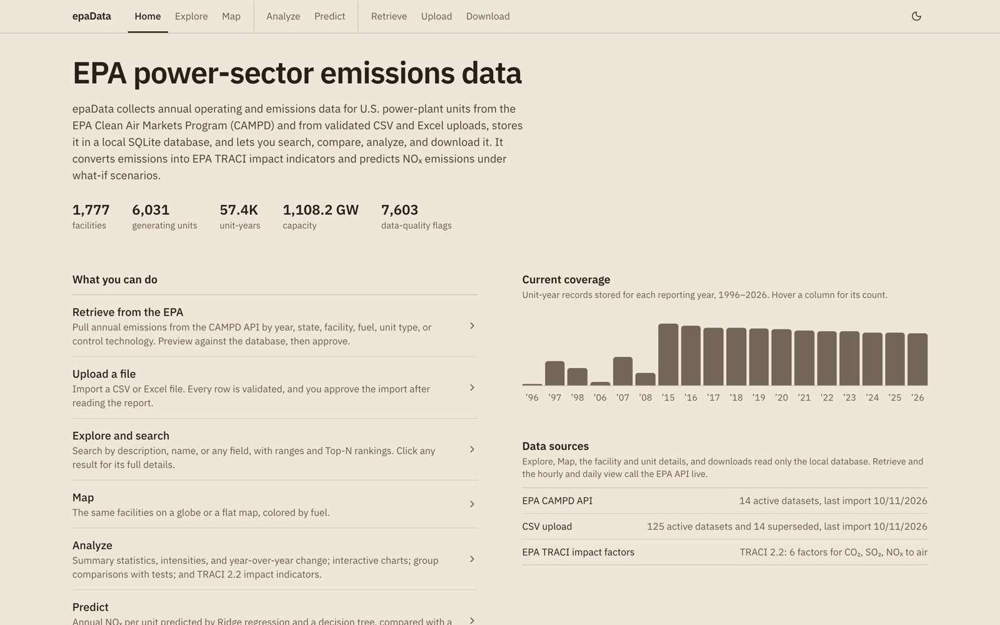
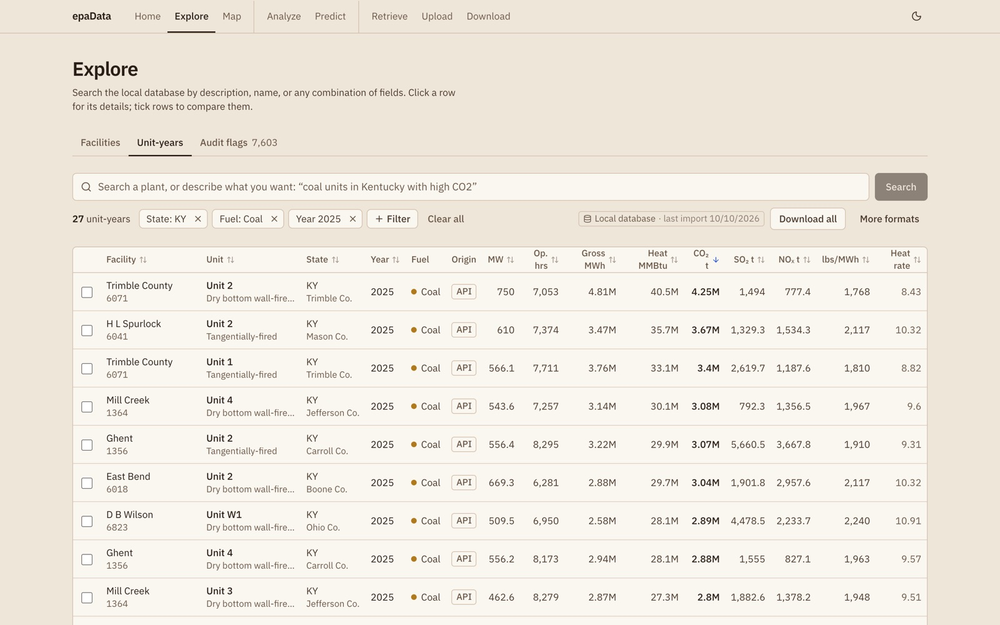
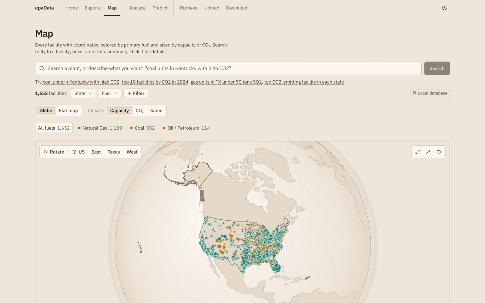
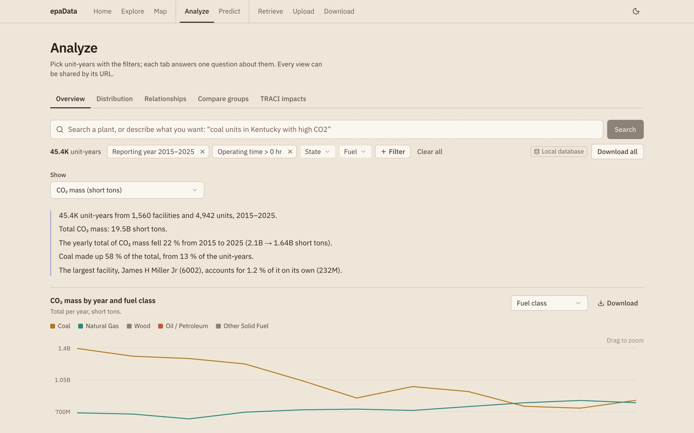
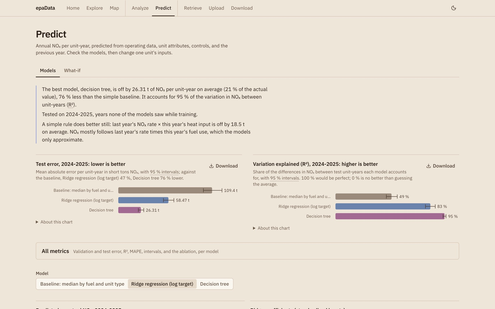
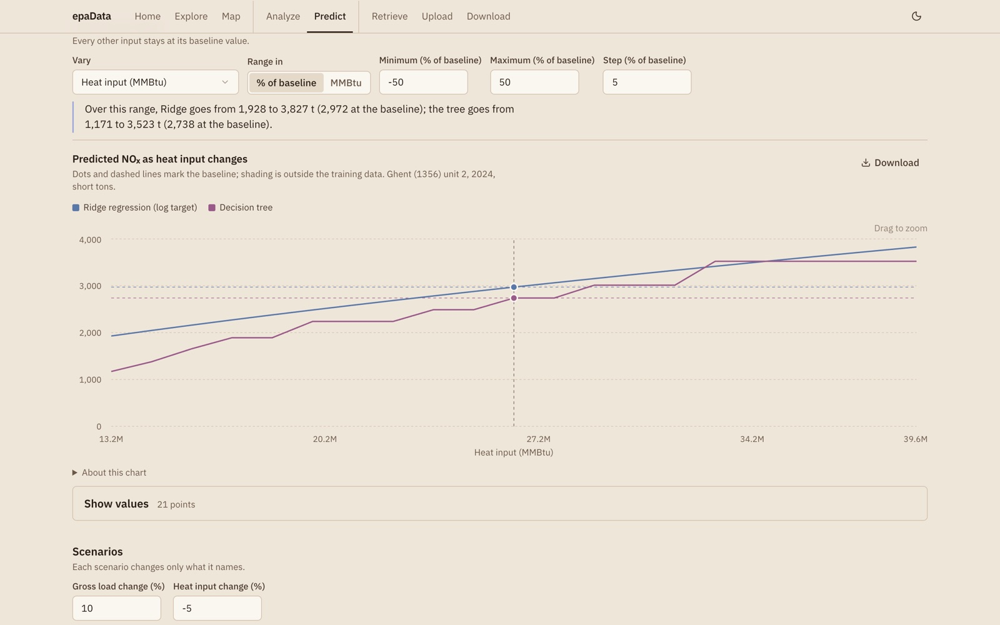
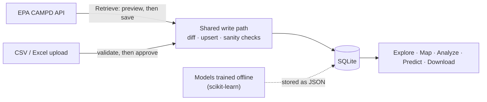
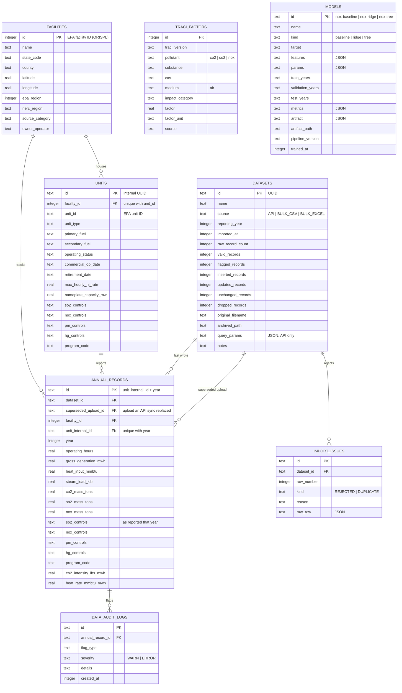

# epaData

**Explore, analyze, and predict U.S. power-plant emissions.**

epaData is a web app for the EPA's Clean Air Markets Program Data (CAMPD). It pulls annual
operating and emissions data for every U.S. power-plant unit from the EPA API or from your own
CSV and Excel files, checks it, and lets you search, map, analyze, and download it. A built-in
NOₓ model answers what-if questions, such as how a unit's emissions change with new controls or
a fuel switch.

**[Live demo →](https://epadata.vercel.app)** The hosted copy is read-only, so Retrieve and Upload
only work when you run it yourself.



## Features

- **Explore**: search 1,777 facilities and 57,000+ unit-years by name, any field, numeric
  ranges, or a plain-English description ("coal units in Kentucky with high CO2"). Rank the top N
  overall or per state, and compare up to four facilities or units side by side.
- **Map**: every facility on a 3D globe or a flat map, colored by fuel and sized by capacity or CO₂.
- **Retrieve and Upload**: pull data from the EPA API or import a CSV or Excel file, review what
  is new, changed, or rejected, and approve before anything is saved. Every record is checked
  against physical-sanity rules.
- **Analyze**: distributions, derived indicators (emission intensity, heat rate, capacity
  factor), correlations, group comparisons with statistical tests, and EPA TRACI 2.2 impact
  indicators.
- **Predict**: annual NOₓ models (Ridge regression and a decision tree, measured against a
  baseline), with sensitivity curves and scenarios.
- **Download**: CSV for any dataset, search, or selection. Analysis exports include the chart
  and a metadata file so results can be reproduced.

Every view lives in the URL, so any search, chart, or prediction can be reloaded or shared. See
the [feature reference](docs/features.md) for the details.

## Screenshots

<table>
  <tr>
    <td width="50%"><br><sub><b>Explore</b>: filters as chips, sortable results, CSV export</sub></td>
    <td width="50%"><br><sub><b>Map</b>: every facility on a globe or flat map</sub></td>
  </tr>
  <tr>
    <td><br><sub><b>Analyze</b>: a plain-language reading above every chart</sub></td>
    <td><br><sub><b>Predict</b>: each model's test error and R², with 95% intervals</sub></td>
  </tr>
  <tr>
    <td colspan="2"><br><sub><b>What-if</b>: change one input and watch both models respond; shading marks inputs outside the training data</sub></td>
  </tr>
</table>

## How it works



Every write goes through one path that compares incoming rows with what's stored, so you
see what's new, changed, or rejected before approving. Records that fail a physical-sanity
check (for example, power generated with zero operating hours) are kept and flagged, not
dropped. The prediction models are trained offline in Python and stored in the database, and
the app replays them in TypeScript, so predictions are instant and need no Python on the
server. More in [docs/data.md](docs/data.md).

### Prediction results

Annual NOₓ per unit-year, tested on 2024–2025 after training on 2016–2023:

| Model                                  | Mean error (t) |   R² |
| :------------------------------------- | -------------: | ---: |
| Baseline: median by fuel and unit type |          109.4 | 0.49 |
| Ridge regression                       |           58.5 | 0.83 |
| Decision tree                          |           26.3 | 0.95 |

A simple rule, last year's NOₓ rate times this year's heat input, does better still (18.5 t),
because a unit's rate barely changes from year to year. The models earn their place in the
What-if tab, where they show how NOₓ responds to load, controls, and fuel. The full results are
in [docs/features.md](docs/features.md#prediction-results-test-years-20242025-refit-on-20162023).

## Database

Eight SQLite tables, defined with Drizzle ORM in
[`src/server/db/schema.ts`](src/server/db/schema.ts) with versioned migrations in
[`drizzle/`](drizzle). Each facility, unit, and unit-year is stored once, enforced by unique
keys, and every unit-year records the dataset that last wrote it, so you can trace each value
to an EPA sync or a file upload. Rejected and duplicate rows land in `import_issues`, and
sanity-check flags in `data_audit_logs`. The repository includes `db.sqlite`, which holds
1,777 facilities, 6,031 units, and 57,414 unit-years.



Indexes, design decisions, and the row counts per table are in [docs/data.md](docs/data.md);
every column is described in [DATABASE_BREAKDOWN.md](DATABASE_BREAKDOWN.md).

## Quick start

Requires Node.js 20.9+ and Python 3.9+.

```bash
git clone https://github.com/raajbanga/epaData.git && cd epaData
npm install
python3 -m venv epaDataVENV && epaDataVENV/bin/pip install -r requirements.txt
cp .env.example .env
npm run db:migrate
npm run dev
```

Open <http://localhost:3000>. The database ships with the repository, so everything except the
live EPA features works right away, with no API key.

Two optional keys go in `.env`:

| Variable             | Turns on                                                                                                             |
| :------------------- | :------------------------------------------------------------------------------------------------------------------- |
| `CAMPD_API`          | Retrieve and the hourly-to-monthly time series ([get an EPA API key](https://www.epa.gov/airmarkets/cam-api-portal)) |
| `OPENROUTER_API_KEY` | A language-model fallback for description search                                                                     |

The full list is in [docs/development.md](docs/development.md#environment-variables).

## Documentation

| Document                                       | Contents                                                                                   |
| :--------------------------------------------- | :----------------------------------------------------------------------------------------- |
| [Features](docs/features.md)                   | Every page, the data-quality rules, and how description search and prediction work         |
| [Data](docs/data.md)                           | Data sources, what's in the bundled database, the schema, and how to refresh or rebuild it |
| [Development](docs/development.md)             | Requirements, configuration, scripts, reproducing the results, and the code layout         |
| [DATABASE_BREAKDOWN.md](DATABASE_BREAKDOWN.md) | Column-by-column schema reference and which view reads which table                         |
| [samples/](samples/README.md)                  | A sample upload file and the validation report it should produce                           |
| [report/](report/README.md)                    | Project reports and slides                                                                 |

## Tech stack

| Area            | Built with                                                                           |
| :-------------- | :----------------------------------------------------------------------------------- |
| Web app         | Next.js 16, React 19, tRPC 11, TanStack Query, Tailwind CSS 4                        |
| Data            | SQLite (libSQL) with Drizzle ORM; Python for reading uploads                         |
| Charts and maps | Recharts, D3, Leaflet                                                                |
| Prediction      | scikit-learn, trained offline and replayed in TypeScript, so no Python on the server |
| Hosting         | Vercel                                                                               |

## Testing

```bash
npm run validate   # format check, lint, typecheck, unit tests, production build
npm run test:py    # model training pipeline
```

## Team

<table>
  <tr>
    <td align="center"><a href="https://github.com/raajbanga"><br><b>Raaj Banga</b></a><br><sub>Project Manager/Back-end Lead</sub></td>
    <td align="center"><a href="https://github.com/TheRealAxnav"><br><b>Arnav Bawankule</b></a><br><sub>Front-end Lead</sub></td>
  </tr>
</table>

Built for CS396.

## Data and credits

- Emissions, facility, and unit data: U.S. EPA Clean Air Markets Program Data (CAMPD), public
  domain.
- Map shapes: [us-atlas](https://github.com/topojson/us-atlas) and
  [world-atlas](https://github.com/topojson/world-atlas) (ISC license), bundled in
  `public/geo/`.
- Basemap tiles: © OpenStreetMap contributors, © CARTO.
