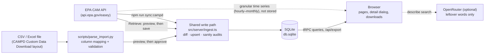
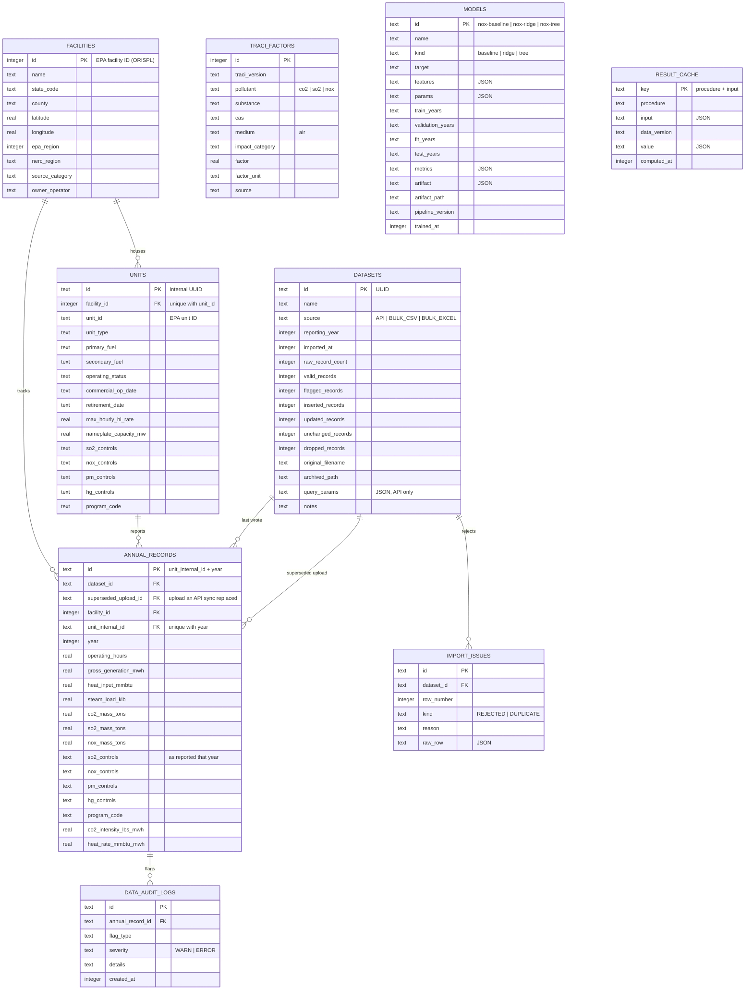

# Data

Where epaData's data comes from, what ships in `db.sqlite`, how it is stored, and how to rebuild it. Column-by-column details are in [DATABASE_BREAKDOWN.md](../DATABASE_BREAKDOWN.md).

## Where the data comes from

Explore, Map, the detail dialog, comparisons, audit flags, and downloads read **only the local
database**. Two features call the **EPA API live**: Retrieve (which then writes to the
database) and the granular time series.



| View                                                          | Source                                                       |
| :------------------------------------------------------------ | :----------------------------------------------------------- |
| Home coverage strip and tiles, Facilities, Units, Map, Audits | Local database                                               |
| Facility and unit detail, Compare                             | Local database                                               |
| Granular time series: Yearly                                  | Local database (`annual_records`)                            |
| Granular time series: Hourly, Daily, Weekly, Monthly          | EPA API, live; not stored                                    |
| Retrieve: "Already in the database" panel                     | Local database                                               |
| Retrieve: preview                                             | EPA API, live; nothing is written until **Approve and save** |
| Upload: validation report                                     | The uploaded file, compared with the local database          |
| Download (all six types)                                      | Local database                                               |

Each panel carries a label saying which source it shows ("Local database · last import …"
or "Live EPA API"). Every unit-year also records the dataset that last wrote it, shown
as its **Origin** (CAMPD API or file upload) in the Unit-years table, the unit details, and the CSV
exports.

## Contents of the committed database

`db.sqlite` is committed, so the app works right after setup without an API key or seeding.

| Table             |   Rows | Notes                                                                                                                                                                               |
| :---------------- | -----: | :---------------------------------------------------------------------------------------------------------------------------------------------------------------------------------- |
| `facilities`      |  1,777 | 50 states, DC, and Puerto Rico                                                                                                                                                      |
| `units`           |  6,031 | 1,108.2 GW nameplate capacity                                                                                                                                                       |
| `annual_records`  | 57,414 | One row per facility-unit-year: 6,467 from uploads (1996–98, 2006–08) and 50,947 from the CAMPD API (2015–2026; 2026 is partial). 176 API records replaced uploaded 2023–25 records |
| `datasets`        |    153 | 14 CAMPD API syncs, 13 facility-file uploads, and 126 daily-emissions uploads (14 uploads superseded by the API sync)                                                               |
| `data_audit_logs` |  7,603 | Physical-sanity flags on 7,056 records: 6,516 CO₂ not reported, 963 extreme heat rates (WARN), 124 zero emissions with high heat input (ERROR)                                      |
| `import_issues`   |      0 | Filled by uploads and retrievals that reject or skip rows                                                                                                                           |
| `traci_factors`   |      6 | TRACI 2.2 factors for CO₂, SO₂, and NOₓ to air (`npm run traci:import`)                                                                                                             |
| `models`          |      3 | The NOₓ baseline, Ridge, and decision-tree models with metrics and parameters (`npm run ml:train`)                                                                                  |
| `result_cache`    |     90 | Stored Analyze results, keyed by procedure and input and stamped with the data version (`npm run db:precompute`)                                                                    |

## Database

Nine tables in SQLite, defined with Drizzle ORM in `src/server/db/schema.ts`, migrations in
`drizzle/`. Facility, unit, and unit-year uniqueness is enforced by the primary key on
`facilities.id` and unique indexes on `units(facility_id, unit_id)` and
`annual_records(unit_internal_id, year)`. Foreign keys cascade on delete, except `annual_records.superseded_upload_id`, which is set to
null. Column-by-column
details: [DATABASE_BREAKDOWN.md](../DATABASE_BREAKDOWN.md).

Secondary indexes cover the common searches: facilities by state, name, county, NERC region,
and source category; units by facility, primary fuel, and operating status;
`annual_records(year, co2_mass_tons)` for year filters and CO₂ ranking;
`annual_records(facility_id, year)` for per-facility totals within a year;
`annual_records` by dataset and by superseded upload; and the foreign
keys of `data_audit_logs` and `import_issues`. The `(facility_id, year)` index matters: with
only a `facility_id` index, SQLite answered "per-facility CO₂ in 2024" by scanning all of 2024
once per facility, and the top-facility-per-state query took 9.5 s instead of 22 ms.



Design assumptions to be aware of:

- **Controls and program codes are stored per unit-year** on `annual_records`; `units` keeps the latest values for display. Fuel and unit type are
  still per unit, so the latest import wins for those.
- **Metrics are `NULL` when not reported.** A total adds what was reported (and is missing when nothing was); range filters and
  percentile thresholds skip them; CSV exports leave them blank.
- **`annual_records.dataset_id` is the dataset that last wrote the record.** Re-importing a
  year moves its records to the new dataset; the older dataset stays in the history as
  "superseded". Values are overwritten, not versioned. An API sync that replaces an uploaded
  record remembers that upload in `superseded_upload_id`.
- **Origin is known per unit-year only.** Facility and unit rows have no dataset link.

## Refreshing or rebuilding the data

The committed database was built with these commands; you only need them to extend or rebuild
it. They read `.env` themselves.

```bash
npm run sync:campd                           # last calendar year
npm run sync:campd -- --year 2024            # one year
npm run sync:campd -- --from 2015 --to 2025  # a range (one dataset per year)
npm run db:seed -- --csv-dir "../CAMPD DATA" # facilities + units from CAMPD facility CSVs
# Full rebuild (delete db.sqlite first): facility CSVs, then every csv/emissions-daily-*.csv rolled
# up to unit-year totals, each imported as an upload; then the API years on top
npm run db:rebuild -- --facility-dir ../epaData/csv --csv-dir csv
npm run sync:campd -- --from 2015 --to 2026
npm run traci:import                         # TRACI 2.2 factors from data/traci
npm run ml:train                             # retrain the models (needs the Python venv)
npm run db:precompute                        # refresh the stored Analyze results
```

`sync:campd` writes directly. The **Retrieve** page does the same with a preview and an
approval step, and records the same dataset history.

After editing `src/server/db/schema.ts`, generate a migration with `npm run db:generate` and
apply it with `npm run db:migrate`.
